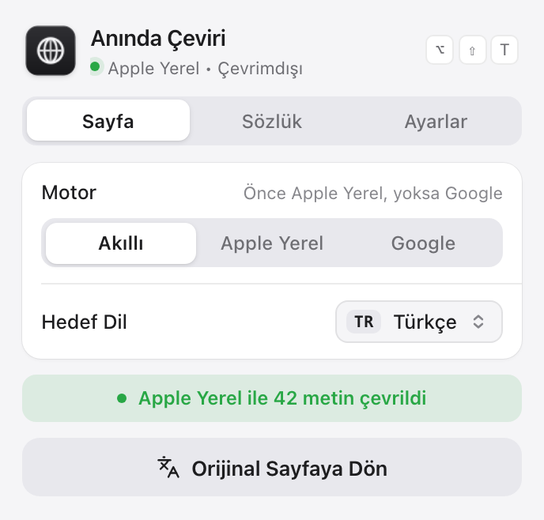
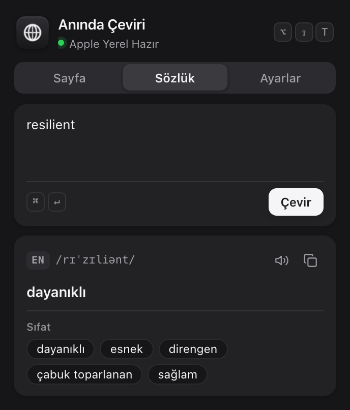
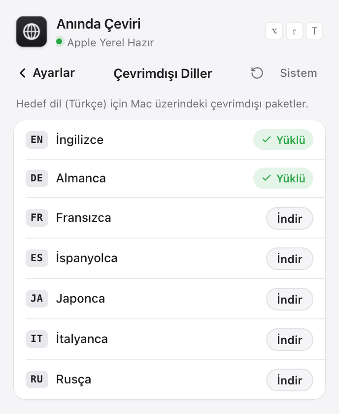
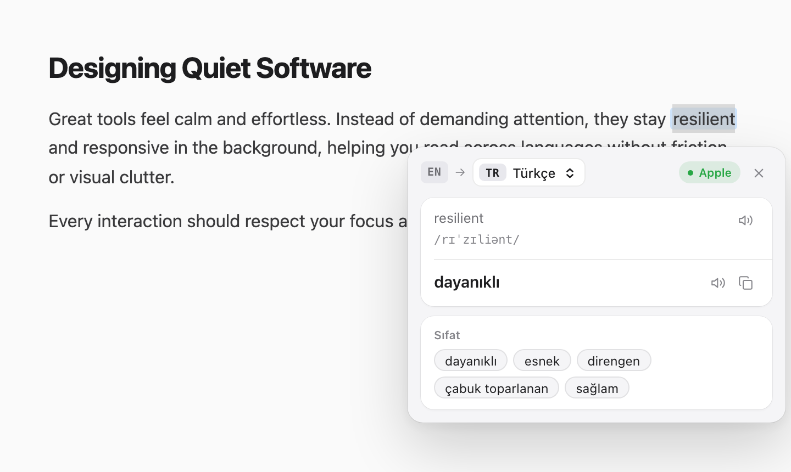

<p align="center">
  
</p>

<h1 align="center">Anında Çeviri (Instant Translator)</h1>

<p align="center">
  A free, zero-API-key Chrome extension that translates the current webpage and selected words in place, with optional <strong>offline on-device Apple Translation</strong> on macOS.
</p>

<p align="center">
  <a href="README.md">Türkçe</a> · <strong>English</strong>
</p>

<p align="center">
  
  
  
  
  <a href="LICENSE"></a>
</p>

---

## Features

- **One-Click In-Place Page Translation:** Translates the active page while preserving layout and skipping `<code>` / `<pre>` blocks, with instant one-click revert to the original page. Prioritizes viewport-visible content first.
- **Dual Translation Engines (Smart / Apple Local / Google):**
  - **Apple Local (Offline):** Uses macOS's built-in `Translation` framework to translate entirely on-device on Apple Silicon with zero internet traffic and no rate limits.
  - **Google Translate (Free):** Works out of the box across all languages with no API key required.
  - **Smart Mode:** Tries Apple Local first and seamlessly falls back to Google Translate if a language pack isn't downloaded or supported on your Mac.
- **In-Page Word & Dictionary Popover:** Highlight any word or phrase on any page to open a clean floating **`Çevir`** trigger and rich popover with phonetic transcription, text-to-speech playback, one-click copy, and part-of-speech dictionary meanings.
- **Offline Language Pack Manager:** Check which Apple language packs are installed on your Mac and trigger macOS's native download prompt right from `Settings → Apple Çevrimdışı Dilleri`.
- **macOS-Inspired UI & Theme Sync:** Custom components, sliding segmented controls, and instant **System / Light / Dark** theme switching synchronized across both the toolbar popup and the in-page popover.
- **Dynamic Content Observer:** Automatically translates newly loaded content as you scroll on infinite feeds and SPAs.

---

## Screenshots

<table>
  <tr>
    <td align="center" width="33%">
      <br />
      <sub><b>Page Translation (Light)</b></sub>
    </td>
    <td align="center" width="33%">
      <br />
      <sub><b>Quick Dictionary (Dark)</b></sub>
    </td>
    <td align="center" width="33%">
      <br />
      <sub><b>Apple Offline Languages</b></sub>
    </td>
  </tr>
</table>

<p align="center">
  <br />
  <sub><b>In-Page Word & Dictionary Popover</b></sub>
</p>

---

## Installation (1 Minute)

### 1. Load the Extension in Chrome
1. Clone or download this repository:
   ```bash
   git clone https://github.com/imhalid/aninda-ceviri.git
   ```
2. Open `chrome://extensions` in your Chromium browser.
3. Enable **Developer mode** in the top-right corner.
4. Click **Load unpacked** and select the `aninda-ceviri` folder.

> The extension works immediately with **Google Translate** with zero additional setup.

### 2. Install the Apple Local Translation Bridge (Optional — macOS 15+)

To enable offline on-device translation via Apple's `Translation` framework, paste and run this **single command** in Terminal *(you can also copy it directly from the extension's **Settings** tab)*:

```bash
curl -fsSL https://raw.githubusercontent.com/imhalid/aninda-ceviri/main/install-bridge.sh | bash
```

What this script does automatically:
1. Installs the Swift source files into `~/Library/Application Support/AnindaCeviri` (or copies from your local clone).
2. Compiles `apple-translator` and `AppleLanguageDownloader.app` using `swiftc`.
3. Registers `NativeMessagingHosts/com.halit.apple_translator.json` for Chrome, Arc, Brave, Edge, Chromium, and Vivaldi.
4. Runs a live `ping` verification against the compiled binary.

Once installed, click **Bağlantıyı Test Et** inside the extension's Settings tab to activate Apple Local mode.

---

## How the Apple Bridge Works

Chrome extensions run inside a browser sandbox and cannot directly call native macOS Swift frameworks. To connect safely without opening local HTTP ports or running background daemons, the extension uses Chrome's **Native Messaging** protocol:

```text
[ Chrome Extension (background.js) ]
        │
        │  chrome.runtime.connectNative("com.halit.apple_translator")
        │  (4-byte little-endian length-prefixed JSON over stdio)
        ▼
[ ~/Library/Application Support/AnindaCeviri/apple-translator ]
        │
        ├─▶ NaturalLanguage (NLLanguageRecognizer) ──▶ Detects source language
        ├─▶ Translation (LanguageAvailability)     ──▶ Checks installed offline packs
        ├─▶ TranslationSession.translations(from:) ──▶ Translates batches on-device
        └─▶ AppleLanguageDownloader.app            ──▶ Opens native macOS download prompt
```

- **Deterministic Extension ID:** The `"key"` field in [manifest.json](manifest.json) keeps the unpacked extension ID fixed (`dimgcaflkglcjgplekclkclpchkcapgh`), restricting Native Messaging access strictly to this extension.
- **Zero Background Overhead:** Chrome spawns the host process only when needed and closes it when idle.
- **Requirements:** macOS 15+ (Sequoia / Tahoe) and `swiftc` (Xcode Command Line Tools — install via `xcode-select --install` if missing).

---

## Shortcuts

- **Translate / Revert Current Page:** `Alt + Shift + T` (macOS: `Option + Shift + T`)
- **Quick Dictionary Translate:** `Cmd + Enter` / `Ctrl + Enter`
- **Context Menu:**
  - *Bu Sayfayı Çevir / Orijinale Dön* (Translate / Revert Page)
  - *Seçili Metni / Kelimeyi Çevir* (Translate Selection)

---

## Project Structure

```text
aninda-ceviri/
├── manifest.json                         # Manifest V3 configuration & permissions
├── background.js                         # Google + Apple Native Messaging router & cache
├── content.js                            # In-place DOM translator & selection popover
├── popup.html / popup.css / popup.js     # Page, Dictionary, Settings & Packs UI
├── install-bridge.sh                     # One-line macOS Apple Bridge installer
├── native-host/
│   ├── main.swift                        # Native Messaging Swift host (NaturalLanguage + Translation)
│   ├── downloader.swift                  # Native macOS language pack download helper
│   └── AppleLanguageDownloader.app/      # Helper bundle Info.plist
├── screenshots/                          # UI screenshots
└── icons/                                # Extension icons (16, 48, 128 px)
```

---

## License

[MIT](LICENSE)
