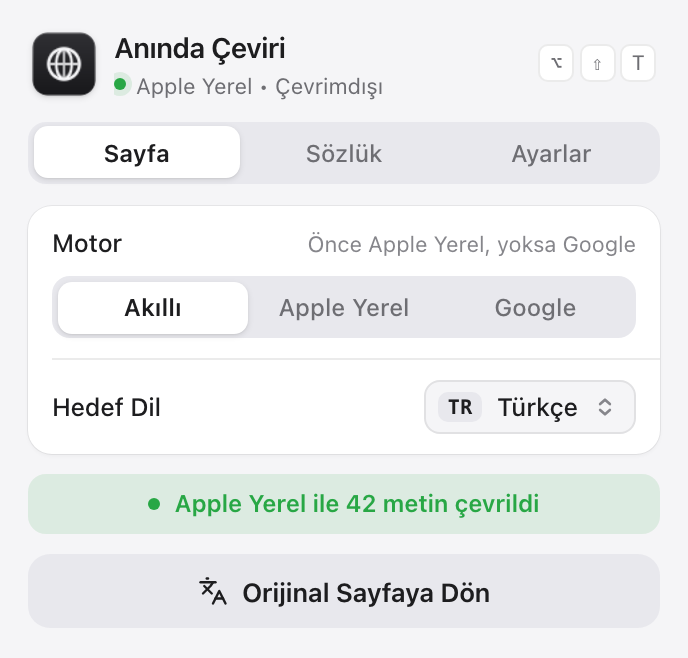
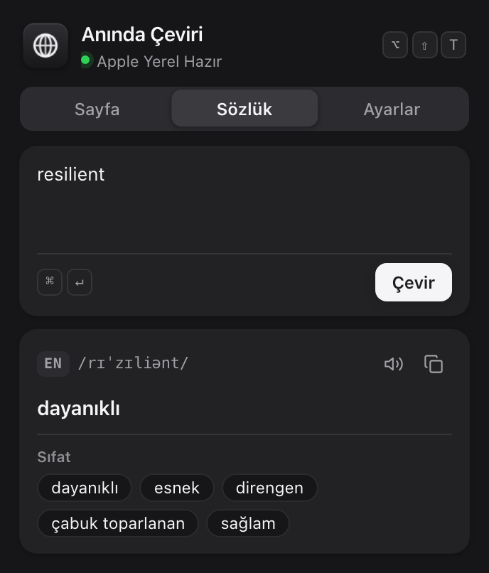
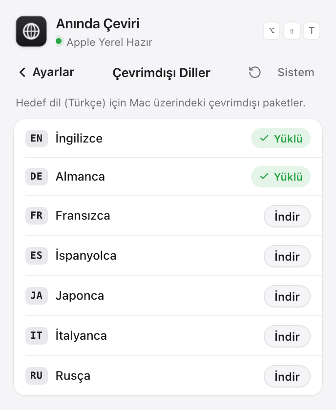
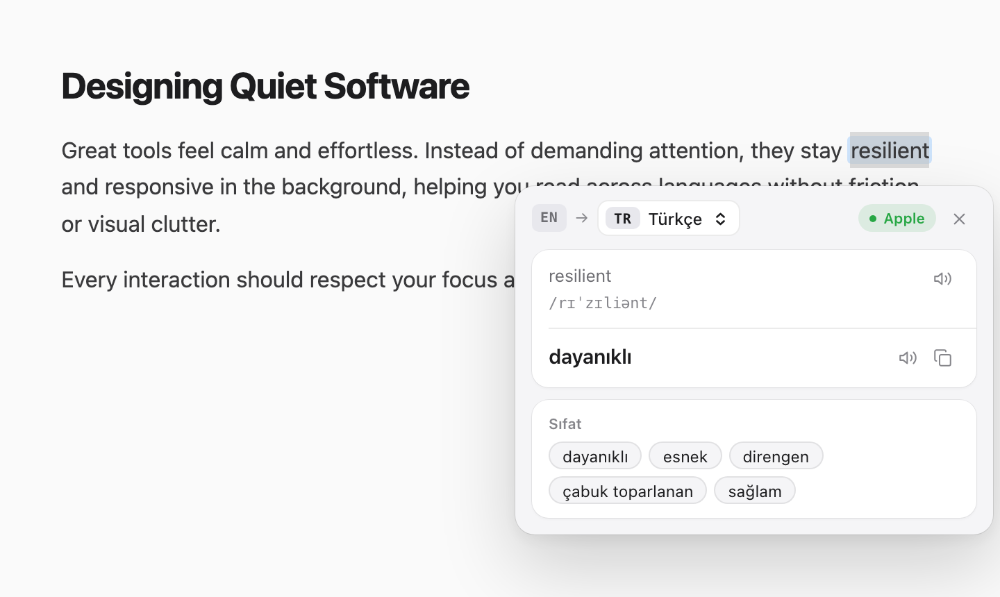

<p align="center">
  
</p>

<h1 align="center">Anında Çeviri</h1>

<p align="center">
  Bulunduğunuz web sayfasını ve seçtiğiniz kelimeleri tek tıkla anında çeviren, macOS üzerinde <strong>Apple Translation</strong> ile tamamen <strong>çevrimdışı</strong> çalışabilen ücretsiz Chrome eklentisi.
</p>

<p align="center">
  
  
  
  
  <a href="LICENSE"></a>
</p>

---

## Özellikler

- **Tek Tıkla Anında Sayfa Çevirisi:** Bulunduğunuz sayfayı sayfa düzenini ve `<code>` / `<pre>` bloklarını bozmadan yerinde çevirir; tek tıkla orijinal haline geri döndürür. Önce ekranda görünen (viewport içi) alanları çevirir.
- **Çift Motor Desteği (Akıllı / Apple Yerel / Google):**
  - **Apple Yerel (Çevrimdışı):** Mac'inizdeki yerleşik `Translation` framework'ünü kullanarak verileri internete çıkarmadan, hız limiti olmadan Apple Silicon üzerinde çevirir.
  - **Google Çeviri (Ücretsiz):** API anahtarı gerektirmeden tüm diller için çalışır.
  - **Akıllı Mod:** Önce Apple Yerel motorunu dener; ilgili dil paketi Mac'inizde yüklü değilse veya desteklenmiyorsa otomatik olarak Google yedeğine geçer.
- **Sayfa İçi Sözlük & Kelime Popover'ı:** Herhangi bir sayfada kelime veya cümle seçtiğinizde yanında çıkan **`Çevir`** balonuna tıklayarak fonetik okunuşu, sesli dinlemeyi, kopyalamayı ve kelime türüne (*İsim, Fiil, Sıfat...*) göre ayrılmış anlamları görebilirsiniz.
- **Eklenti İçinden Apple Dil Paketi İndirme:** `Ayarlar → Apple Çevrimdışı Dilleri` altından Mac'inizde hangi dillerin yüklü olduğunu görebilir ve tek tıkla Apple'ın resmi sistem indirme penceresini başlatabilirsiniz.
- **macOS Çizgisinde Arayüz & Tema Desteği:** Özel seçiciler, kayan segment kontrolleri ve anlık **Sistem / Açık / Koyu** tema geçişi (hem eklenti popup'ında hem sayfa içi popover'da senkronize çalışır).
- **Dinamik İçerik Takibi:** Sosyal akışlar ve SPA sitelerde kaydırdıkça yeni yüklenen metinleri otomatik çevirir.

---

## Ekran Görüntüleri

<table>
  <tr>
    <td align="center" width="33%">
      <br />
      <sub><b>Sayfa Çevirisi (Açık Tema)</b></sub>
    </td>
    <td align="center" width="33%">
      <br />
      <sub><b>Hızlı Sözlük (Koyu Tema)</b></sub>
    </td>
    <td align="center" width="33%">
      <br />
      <sub><b>Apple Çevrimdışı Dilleri</b></sub>
    </td>
  </tr>
</table>

<p align="center">
  <br />
  <sub><b>Sayfa İçi Kelime & Sözlük Popover'ı</b></sub>
</p>

---

## Kurulum (1 Dakika)

### 1. Eklentiyi Chrome'a Yükleyin
1. Bu depoyu indirin veya klonlayın:
   ```bash
   git clone https://github.com/imhalid/aninda-ceviri.git
   ```
2. Tarayıcınızda `chrome://extensions` adresini açın.
3. Sağ üstten **Geliştirici modu (Developer mode)** anahtarını açın.
4. **Paketsiz öğe yükle (Load unpacked)** butonuna tıklayıp `aninda-ceviri` klasörünü seçin.

> Bu adımdan sonra eklenti **Google Çeviri** motoruyla hemen ücretsiz çalışmaya başlar.

### 2. Apple Yerel Çeviri Köprüsünü Kurun (İsteğe Bağlı — macOS 15+)

Mac'inizin kendi çevrimdışı `Translation` motorunu kullanmak için aşağıdaki **tek komutu** kopyalayıp Terminal'e yapıştırmanız yeterlidir *(aynı komuta eklentinin **Ayarlar** sekmesinden de tek tıkla kopyalayarak ulaşabilirsiniz)*:

```bash
curl -fsSL https://raw.githubusercontent.com/imhalid/aninda-ceviri/main/install-bridge.sh | bash
```

Bu komut şunları otomatik yapar:
1. Gerekli Swift kaynak dosyalarını `~/Library/Application Support/AnindaCeviri` içine alır (yerel klondan çalıştırırsanız doğrudan repodaki dosyaları kullanır).
2. `apple-translator` köprüsünü ve `AppleLanguageDownloader.app` yardımcısını `swiftc` ile Apple Silicon / Intel uyumlu olarak derler.
3. Chrome, Arc, Brave, Edge, Chromium ve Vivaldi için `NativeMessagingHosts/com.halit.apple_translator.json` kaydını oluşturur.
4. Köprüye canlı `ping` testi atıp desteklenen Apple dillerini doğrular.

Kurulum bittikten sonra eklentinin **Ayarlar** sekmesindeki **Bağlantıyı Test Et** butonuna basmanız yeterlidir.

---

## Apple Bridge Nasıl Çalışır?

Tarayıcı eklentileri güvenlik (sandbox) nedeniyle işletim sisteminin yerel Swift framework'lerine doğrudan erişemez. Bunu güvenli ve arka planda port/sunucu açmadan çözmek için Chrome'un resmi **Native Messaging** protokolü kullanılır:

```text
[ Chrome Eklentisi (background.js) ]
        │
        │  chrome.runtime.connectNative("com.halit.apple_translator")
        │  (4-byte little-endian uzunluk + UTF-8 JSON / stdio)
        ▼
[ ~/Library/Application Support/AnindaCeviri/apple-translator ]
        │
        ├─▶ NaturalLanguage (NLLanguageRecognizer) ──▶ Kaynak dili algılar
        ├─▶ Translation (LanguageAvailability)     ──▶ Mac'teki dil paketi durumunu kontrol eder
        ├─▶ TranslationSession.translations(from:) ──▶ Metinleri yerel olarak çevirir
        └─▶ AppleLanguageDownloader.app            ──▶ İstenen dil için sistem indirme onayını açar
```

- **Sabit Uzantı Kimliği:** [manifest.json](manifest.json) içindeki `"key"` alanı sayesinde paketsiz kurulumda bile uzantı kimliği (`dimgcaflkglcjgplekclkclpchkcapgh`) sabit kalır; böylece Native Messaging yalnızca bu eklentiden gelen isteklere izin verir.
- **Sıfır Arka Plan Yükü:** Köprü yalnızca Chrome çeviri veya dil kontrolü istediğinde başlatılır; açık port veya sürekli çalışan daemon bırakmaz.
- **Gereksinimler:** macOS 15+ (Sequoia / Tahoe) ve `swiftc` (Xcode Command Line Tools — yoksa `xcode-select --install`).

---

## Kısayollar ve Kullanım

- **Sayfayı Çevir / Orijinale Dön:** `Alt + Shift + T` (Mac: `Option + Shift + T`)
- **Hızlı Sözlük İçi Çeviri:** `Cmd + Enter` / `Ctrl + Enter`
- **Sağ Tık Menüsü:**
  - *Bu Sayfayı Çevir / Orijinale Dön*
  - *Seçili Metni / Kelimeyi Çevir*

---

## Proje Yapısı

```text
aninda-ceviri/
├── manifest.json                         # Manifest V3 yapılandırması ve izinler
├── background.js                         # Google + Apple Native Messaging yönlendiricisi ve önbellek
├── content.js                            # DOM sayfa çevirisi ve sayfa içi sözlük popover'ı
├── popup.html / popup.css / popup.js     # Sayfa, Sözlük, Ayarlar ve Dil Paketi arayüzü
├── install-bridge.sh                     # Tek komutluk macOS Apple Bridge kurulum betiği
├── native-host/
│   ├── main.swift                        # Native Messaging Swift host (NaturalLanguage + Translation)
│   ├── downloader.swift                  # Resmi sistem dil indirme onay penceresi
│   └── AppleLanguageDownloader.app/      # Uygulama paketi yapılandırması (Info.plist)
├── screenshots/                          # Arayüz ekran görüntüleri
└── icons/                                # Uzantı ikonları (16, 48, 128 px)
```

---

## Lisans

[MIT](LICENSE)
